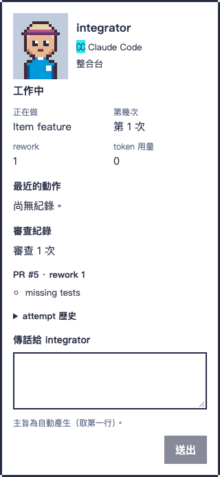

# Seat inspector

Mount the exported component in the office page's right-column slot under its
existing `RealtimeProvider`:

```tsx
<SeatInspector seatId={selectedSeatId} />
```

The office page owns selection and its URL query parameter. The inspector reads
`selectDisplayedModel` through the realtime hooks, computes its VM outside the
store, and disables writes whenever `replay !== null`, including initial replay
loading. A new seat or attempt resets the local message draft. The API client
generates the subject from the first line; submissions are never retried
implicitly because this endpoint has no idempotency key.

Review reasons are not in the read model. The connection layer subscribes before
paging the workflow event log, retains only review metadata, deduplicates by seq,
and filters at the displayed model's watermark. Review count is the number of
`in_review` transitions for the displayed work item; rework count comes from the
work item projection. When the merge queue clears after returning an item, the
last item reviewed by this seat remains visible. Failed history loading is shown
explicitly with a retry action.

The optional M2 `rateLimited: {since, resetsAt?} | null` field follows the name
registry in M4_PLAN §5.3. A non-null value shows the waiting-for-quota state until
M2 clears it; no local deadline guess or contract change is needed.

## Harness and verification

After `pnpm -r build`, start `pnpm dev:office --fake demo --auto-merge-final 0`.
Open the printed frontend origin at:

- `/src/features/seats/test-support/index.html?state=rework`
- `/src/features/seats/test-support/index.html?state=meeting`
- `/src/features/seats/test-support/index.html?state=implement&seat=wf1%3Aengineer%3Afeature`

These fixture views mock fetch and cannot send to the backend. For a real fake
workflow, authenticate at the printed bootstrap link and use
`?workflow=<workflowId>&seat=<seatId>` instead; that mode uses the actual API and
SSE. The harness is outside the production entry and build.

Unit/component tests cover all inspector sections, review paging and replay
filtering, optional rate-limit state, message guards, errors, pending duplicate
submits, and draft reset when selection changes. T10's manual Chromium check
started a demo workflow with optional gates disabled, sent through this real-mode
harness, and verified the matching persisted `message.instruction` event through
`GET /workflows/:id/events`; its isolated workflow was then cancelled. T15's
`apps/e2e` workspace is not present in this base, so promotion into that suite is
an integration follow-up.


